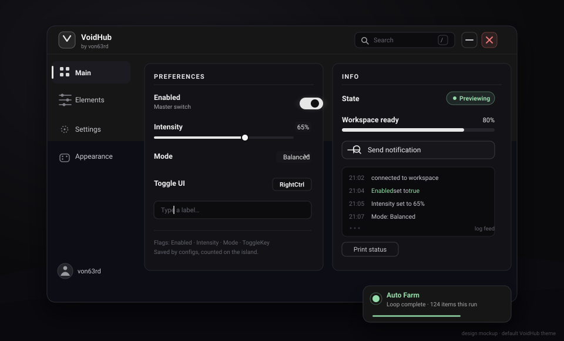
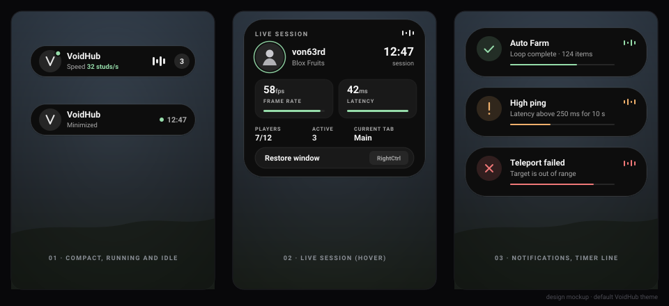
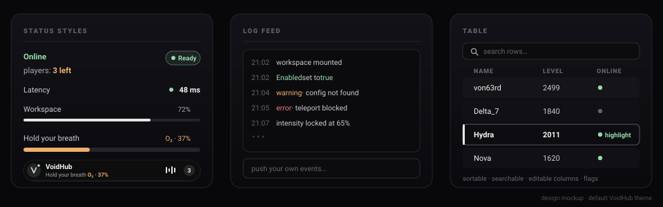

<div align="center">


# VoidHub

**A single-file Roblox client UI library by von63rd.**

[](Source.lua)
[](#metadata)
[](#license)

Window · Dynamic Island · controls · themes · configs

</div>

VoidHub is a Luau UI library for Roblox client executor scripts: a window with tabs, sub-tabs, responsive groupboxes, native controls, window-wide search, flags and configuration helpers, appearance profiles, notifications, and a draggable minimized island that never stops being alive.

It ships as readable Lua source, not a Studio project. Load `Source.lua`, create a window, add the UI your script needs. The bundled `Example.lua` is a standalone showcase; its controls demonstrate UI behavior only and do not automate gameplay.

<div align="center">







<sub>Interface previews · design mockups rendered from the default VoidHub theme · not in-game captures</sub>

</div>

## Quick start

Run this in a compatible client executor for an experience you own or are authorized to test:

```lua
local Library = loadstring(game:HttpGet(
    "https://raw.githubusercontent.com/voidhub9-dotcom/VoidHub-UI/main/Source.lua"
))()

local Window = Library:CreateVoidHubWindow({
    Name = "VoidHub",
    LoadingSubtitle = "by von63rd",
})

local Main = Window:CreateTab({
    Name = "Main",
    Icon = "layout-grid",
})

local Controls = Main:CreateGroupbox({
    Name = "Controls",
    Side = "Left",
})

Controls:CreateToggle({
    Name = "Enabled",
    Flag = "Demo_Enabled",
    CurrentValue = true,
    Callback = function(value)
        print("Enabled:", value)
    end,
})

Controls:CreateSlider({
    Name = "Intensity",
    Range = { 0, 100 },
    Increment = 5,
    CurrentValue = 65,
    Suffix = "%",
})

Window:CreateAppearanceTab({ Name = "Appearance", Icon = "palette" })
Window:SelectTab(Main)
```

The enhanced factory defaults to **VoidHub**, the monochrome palette, and the silver V logo `rbxassetid://101833678008843`. Use `Icon` (or `Image`) to override the logo. A saved player theme can still take precedence, and the default config folder stays `AquaHub`, so the rebrand does not move existing data.

### Standalone showcase

```lua
loadstring(game:HttpGet(
    "https://raw.githubusercontent.com/voidhub9-dotcom/VoidHub-UI/main/Example.lua"
))()
```

`Example.lua` embeds the library and needs no second copy of `Source.lua`. It demonstrates selected controls and the appearance editor without gameplay automation.

## The Dynamic Island

Minimizing folds the window into a black pill hanging from the top of the screen, lit by a soft accent glow with a shadow that lifts it off the game.

- **Compact** — the glyph tile carries a live dot while anything runs, a waveform dances next to the session clock, a corner badge shows the running count, and a pinned status joins the subtitle line with its value tinted.
- **Hover** (desktop, or `IslandStyle = "Always Show"`) — the pill springs open into a live session card: avatar, game, session time, frame rate and latency meters, players, running count, current tab, and a restore button with the UI keybind.
- **Notifications** — a notification that arrives while minimized drops into the island and dyes the chip, the title, and the glow with its type colour.
- **Drag** — press and pull to move it anywhere; drop it near the top centre and it snaps home. The position persists. `Window:ResetIslandPosition()` undoes it, and `Window:SetIslandStyle` picks between `Show on Hover` and `Always Show`.

The morph engine carries all of this: the window squeezes into the pill, springs it open, and settles every state with the same elastic timing.

## Tabs, groupboxes, and controls

Create tabs on the window, then place groupboxes on a tab (`Side = "Left"` or `"Right"`). Elements added directly to a tab become full-width cards. Groupboxes are the normal choice.

```lua
local Settings = Window:CreateTab({ Name = "Settings", Icon = "settings" })
local Left = Settings:CreateGroupbox({ Name = "Preferences", Side = "Left" })
local Right = Settings:CreateGroupbox({ Name = "Actions", Side = "Right" })

Left:CreateDropdown({
    Name = "Mode",
    Options = { "Safe", "Balanced", "Fast" },
    CurrentOption = "Balanced",
    Flag = "Mode",
})

Right:CreateButton({
    Name = "Print status",
    Callback = function()
        print("VoidHub is ready")
    end,
})
```

| Group | Constructors |
| --- | --- |
| Input | `CreateButton`, `CreateButtonRow`, `CreateToggle`, `CreateSlider`, `CreateStepper`, `CreateDropdown`, `CreateOrderList`, `CreateInput`, `CreateKeybind`, `CreateColorPicker` |
| Display | `CreateLabel`, `CreateParagraph`, `CreateSection`, `CreateDivider`, `CreateImage`, `CreateProgress` |
| Feedback | `CreateStatus`, `CreateStatuses`, `CreateStatusList`, `CreateTable`, `CreateLog` (`CreateFeed`) |
| Built-in | `CreateConfigManager`, `CreateThemeManager`, `CreateMinimizeOnStart` |

Most value controls accept `Name`, `Desc`, `Tooltip`, `Visible`, `Disabled`, `DependsOn`, and a unique `Flag`. Handles expose the applicable `Set` / `Get` methods plus visibility, disabled, dependency, tooltip, and destroy; collection and manager handles have their own documented methods. `llms.txt` carries a compact, source-exact constructor and handle reference.

### Sub-tabs and managers

Tabs can contain sub-tabs (`Tab:CreateSubTab`); once a tab has them, add groupboxes and controls to the sub-tab. `Window:SelectTab(tab)` takes the tab object; `Tab:SelectSubTab(subTab)` also accepts an exact name or a one-based index.

```lua
Settings:CreateConfigManager({ Side = "Left" })
Settings:CreateThemeManager({ Side = "Right" })
```

The window runs a brief one-shot edge sheen when it opens or restores; pass `OpenEffects = false` or call `Window:SetOpenEffects(false)` to disable the sheen without touching window transitions.

## Flags and configuration

Give saveable controls unique `Flag` strings within each window. Flagged controls are reachable through `Window.Flags` and stored by the native configuration API.

```lua
local Enabled = Controls:CreateToggle({
    Name = "Enabled",
    Flag = "MyHub_Enabled",
    CurrentValue = false,
})

Enabled:Set(true, true) -- second argument skips the callback
print(Enabled:Get())
```

`Library.Flags` remains the latest-registered compatibility map, so existing `Library.Flags.SomeFlag` code keeps working; prefer `Window.Flags` for a specific window. Native config calls include `SaveConfig`, `LoadConfig`, `ListConfigs`, `DeleteConfig`, `RenameConfig`, `ExportConfig`, `ImportConfig`, autoload helpers, and the config manager. Set a clear folder:

```lua
local Window = Library:CreateVoidHubWindow({
    ConfigurationSaving = { FolderName = "MyHub" },
})
```

**Configuration caveat:** `ConfigurationSaving.Enabled` is currently not enforced by the implementation. Setting it to `false` does not disable file operations. Native config calls depend on executor file APIs such as `readfile` and `writefile`; configure and call those deliberately.

## Appearance

Appearance methods attach to windows created by `CreateVoidHubWindow` (or its legacy aliases). The optional appearance tab exposes theme selection, background styling, sizing, density, and profile import/export.

```lua
Window:CreateAppearanceTab({ Name = "Appearance", Icon = "palette" })

Library:SetTheme("VoidHub")
Window:SetUIScale(1.1)
Window:SetAdaptiveSize(true)

local profile = Window:ExportAppearance()
if profile then
    print("Appearance profile exported")
end
```

### Themes

```lua
local ok, err = Library:RegisterTheme("My Aqua", {
    Accent = "#7DD3FC",
    AccentDark = "#0C4A6E",
})

if ok then
    Library:SetTheme("My Aqua")
else
    warn(err)
end
```

`RegisterTheme` returns `true`, or `false, error`. Palette keys are `Background`, `Surface`, `Surface2`, `Surface3`, `Stroke`, `StrokeHover`, `Accent`, `AccentDark`, `Text`, `Muted`, `Success`, `Warning`, and `Error`; values may be `Color3` or hex strings, and omitted keys inherit the current theme. Presets include the default `VoidHub` monochrome, the `Aqua` family, `Aqua Ice`, `Aqua Mono`, `Midnight`, and many more; the theme manager lists them all. The island's glow follows the accent, so a colored theme recolors the whole thing.

### Backgrounds and profiles

```lua
local ok, err = Window:SetBackgroundStyle({
    Source = "Cyanic",
    Transparency = 0.25,
    Tint = "#FFFFFF",
    ScaleType = "Crop",
    Dim = 0.2,
})

local style = Window:GetBackgroundStyle()
local json, exportErr = Window:ExportAppearance()
-- Window:ApplyAppearance(json) restores a table or JSON profile.
```

`Source` can be a built-in preset, an accessible asset ID, a supported URL/file source, or `"None"`. `ScaleType` accepts `Crop`, `Fit`, `Tile`, or `Stretch` (`TileSize` is clamped to 1–4096). Invalid or unresolved sources preserve the previous background. Profiles hold theme colors, background style, UI scale, adaptive sizing, density, and corner radius; they are explicit export/import data, not a save file, and they never contain control flags, credentials, or gameplay state. Themes, density, and corner radius are shared by windows in one library instance; backgrounds are per-window.

## Capabilities and safety

VoidHub is a client-side UI library, not a gameplay automation package. Loading needs executor support for `loadstring` and `game:HttpGet`; native configs need file APIs; clipboard actions need a clipboard API; URL/file images and custom fonts depend on the executor's request, file, and custom-asset APIs. Adaptive sizing fits the viewport including touch layouts; it is not physical DPI detection.

Use scripts only in experiences you own or have permission to test, and keep callbacks limited to behavior you intend to run. Demo controls change interface state only.

## Metadata

```lua
Library.VoidHub.Version        -- "1.2.0"
Library.VoidHub.Author         -- "von63rd"
```

The primary factory is `Library:CreateVoidHubWindow(options)`. `Library:CreateAquaHubWindow`, `Library:CreateKawiXDWindow`, and `Library:CreateNullFireWindow` remain compatible aliases; their metadata aliases still work and appearance profiles keep format version 1. The native `Library:CreateWindow(options)` API remains available for a base window without the appearance methods.

## Repository layout

| File | Purpose |
| --- | --- |
| [`Source.lua`](Source.lua) | The complete VoidHub library and appearance extension |
| [`Example.lua`](Example.lua) | Standalone UI showcase with the library embedded |
| [`Readme.MD`](Readme.MD) | Installation, usage, API overview, and license |
| [`llms.txt`](llms.txt) | Compact API guidance for coding assistants |

`design/` holds the logo and the interface preview mockups above. The distribution stays at exactly these four root files.

Repository: [voidhub9-dotcom/VoidHub-UI](https://github.com/voidhub9-dotcom/VoidHub-UI)

## License

The four distributed files are provided under the MIT License.

```text
MIT License

Copyright (c) 2026 voidhub9-dotcom

Permission is hereby granted, free of charge, to any person obtaining a copy
of this software and associated documentation files (the "Software"), to deal
in the Software without restriction, including without limitation the rights
to use, copy, modify, merge, publish, distribute, sublicense, and/or sell
copies of the Software, and to permit persons to whom the Software is
furnished to do so, subject to the following conditions:

The above copyright notice and this permission notice shall be included in all
copies or substantial portions of the Software.

THE SOFTWARE IS PROVIDED "AS IS", WITHOUT WARRANTY OF ANY KIND, EXPRESS OR
IMPLIED, INCLUDING BUT NOT LIMITED TO THE WARRANTIES OF MERCHANTABILITY,
FITNESS FOR A PARTICULAR PURPOSE AND NONINFRINGEMENT. IN NO EVENT SHALL THE
AUTHORS OR COPYRIGHT HOLDERS BE LIABLE FOR ANY CLAIM, DAMAGES OR OTHER
LIABILITY, WHETHER IN AN ACTION OF CONTRACT, TORT OR OTHERWISE, ARISING FROM,
OUT OF OR IN CONNECTION WITH THE SOFTWARE OR THE USE OR OTHER DEALINGS IN THE
SOFTWARE.
```
